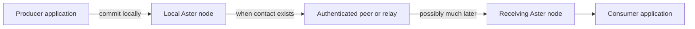

# Aster

**Keep data moving when the network disappears.**

Aster is an offline-first data mesh for applications that cannot depend on a
continuous path to a service. Applications commit data to a local node. Aster
protects it at the source, stores it durably, and exchanges it when an
authenticated contact becomes available.

Direct connections, relays, and central infrastructure can help delivery, but
none is required for the data model to remain correct. Aster is designed for
field teams, vehicles, sensors, and edge systems that move between connected,
constrained, and disconnected operation.

> [!IMPORTANT]
> Aster is an evaluation-stage reference implementation, not a
> production-authorized system. Event, State, Record, and Blob have live Rust
> APIs; Event and Blob also have a local agent API. Review the
> [current implementation boundary](#current-implementation-boundary),
> [security gates](docs/security.md), [conformance status](docs/validation/conformance.md),
> and [requirements status](docs/validation/requirements-status.md) before
> planning a deployment.

The current public Blob capability boundary is machine checked:

<!-- ASTER-BLOB-CAPABILITY:BEGIN -->
```json
{
  "schema": 1,
  "surface": "readme",
  "local_publish_waits_for_peer": false,
  "rust_agent_asterctl_publish_read": "implemented",
  "blob_status_scope": "receiver_local_durable_state",
  "blob_status_reports_remote_delivery_peer_or_convergence": false,
  "cli_download_resume": "post_merge"
}
```
<!-- ASTER-BLOB-CAPABILITY:RENDERED -->
Local Blob publication commits without waiting for a peer. Rust, the native-gRPC agent, and asterctl implement bounded Blob publication and authenticated reads. blob-status reports receiver-local durable state, not remote delivery, peer status, or convergence. CLI download resume is post-merge work; an interrupted download restarts at byte zero.
<!-- ASTER-BLOB-CAPABILITY:END -->

## See it work

Start with **Aster Field Notes**. It opens with no processes running, asks you
to choose short-lived nearby discovery or an explicit invitation route, and
lets you add Atlas, Beacon, and Cove, write durable notes, sleep nodes, and wake
them into the same retained mesh:

    mise install
    mise run hello

The display marks an edge only after authenticated contact and marks a note at
a node only after an exact application query finds that Event. Friendly names
stay local to the display and are never discovery metadata. The
[Field Notes quickstart](docs/quickstart/hello.md) explains the ten-second
nearby windows, no-silent-fallback rule, invitation option, and exact
evaluation boundary.

For a deterministic noninteractive two-node path, run the capability tour. It
starts real processes with independent stores and identities, publishes while
disconnected, reconnects over direct Iroh, and verifies an equal-inventory
second pass:

```sh
mise install
mise run tour
```

Continue with the [capability tour](docs/quickstart/capability-tour.md) for the
relay and control variants. Other runnable paths have their own focused guides:

- [trusted-LAN discovery](docs/quickstart/lan-mvp.md) and its
  [flat scale diagnostic](docs/quickstart/lan-scale.md);
- the [hierarchy MVP](docker/hierarchy-mvp/README.md) and
  [hierarchy scale diagnostic](docs/quickstart/hierarchy-scale.md); and
- the interactive [message playground](docs/quickstart/message-playground.md).

## How Aster moves data



- **Offline publication.** Success means the item is durable locally, not that
  a server happened to be reachable.
- **Store-and-forward delivery.** Protected data can cross several intermittent
  contacts, including relays without content access.
- **Source authentication.** Identity and protected semantic metadata survive
  every hop; carrier identity alone never grants data access.
- **Deterministic convergence.** Nodes reconcile without trusting wall clocks
  or assuming one always-online coordinator.

Read [Core concepts](docs/concepts.md) for the ten-minute mental model.

## Choose a data class

The data class defines how an item converges. It is more than a storage label.

| Class | Best for | Convergence behavior |
|---|---|---|
| **State** | Current position, device status, latest setting | Selects one current value per logical key while retaining meaningful concurrent history |
| **Event** | Messages, observations, audit entries | Preserves immutable publisher order and makes sequence gaps detectable |
| **Record** | Plans, forms, annotations, mutable documents | Preserves concurrent versions for explicit, guarded application resolution |
| **Blob** | Imagery, maps, attachments, large binary objects | Identifies immutable chunked content and supports authenticated streaming |

The [data-class guide](docs/concepts.md#choosing-a-data-class) includes a
decision tree and worked examples.

## Integrate an application

For new integrations, start with the local agent. It exposes the live Event
authority over Connect, gRPC, and gRPC-Web plus bounded Blob publish/read
streams over native gRPC using a checked-in Protobuf schema and does not
require a hosted Buf Schema Registry.

| Integration | Start here | Current boundary |
|---|---|---|
| **Connect, gRPC, or gRPC-Web** | [Local agent](docs/quickstart/connect-agent.md) | Live Event and local status over Connect/gRPC/gRPC-Web; Blob publish/read over native gRPC; authenticated loopback process |
| **Command line** | [asterctl](crates/asterctl/README.md) | CLI utility for introspecting and controlling Aster nodes |
| **Human operator** | [Operator guide](docs/operator-guide.md) | Packaged installation, authentication, health, Event use, and Blob file transfer without developer tooling |
| **Docker Compose deployment** | [Compose container delivery](docs/release/docker-compose.md) | Manual, no-Swarm container profile with a dedicated file-secret provider; no Docker host profile is qualified |
| **Rust selected node** | [Selected Event API](docs/quickstart/selected-event-api.md) | Live Event publish, query, durable delivery, gaps, and status |
| **State or Record in Rust** | [State](docs/quickstart/selected-state-api.md) and [Record](docs/quickstart/selected-record-api.md) | Cloneable live handles and exclusive stopped facades; direct-Iroh reconciliation; State latest-value and Record conflict-preserving delivery |
| **Blob in Rust** | [Blob](docs/quickstart/selected-blob-api.md) | Cloneable `RunningNode::selected_blobs()` handle for durable or finite-TTL file publication, bounded pages, tagged content/retirement delivery, and local durable transfer progress, plus an exclusive stopped facade; semantic v9/profile 5 provides bounded checkpointed large-object streaming, while v7/v8 profile 4 remains the compatibility path |
| **Rust semantic API** | [Rust quickstart](docs/quickstart/rust.md) | Broader proven semantic surface used as the migration source |
| **Python, Go, or C** | [Language quickstarts](docs/quickstart/README.md) | Offline semantic API through the current C ABI, not the selected live node |

### Download and run the Compose images

The manual `Build: Compose images` workflow produces separate native `amd64`
and `arm64` artifacts. A deployment operator selects the artifact with
`uname -m`, downloads it from the reviewed `workflow_dispatch` run, verifies
`SHA256SUMS`, and imports both Docker-loadable archives with
`docker image load`; no local image build is required. Before deployment,
compare each value returned by `docker image inspect --format '{{.Id}}'` with
the corresponding authenticated config or manifest digest in
`release-manifest.json`.

Set `ASTER_AGENT_IMAGE_DIGEST` and `ASTER_ADMIN_IMAGE_DIGEST` to those verified
local image IDs. The Compose model uses `pull_policy: never`, so a missing
local image fails instead of falling back to a registry. Registry digest
references remain supported for registry-based sites. See the
[Compose operator procedure](docs/release/docker-compose.md) for exact download,
verification, import, credential-generation, activation, and Event-validation
commands.

The [application recipes](docs/application-recipes.md) show all four data
classes, queries, subscriptions, batches, deletion, conflicts, and emission
policy. Kubernetes, Zarf, and UDS integrations should treat the ConnectRPC
agent as the application boundary; deployment packaging and protected
provisioning remain open work.

## Current implementation boundary

| Surface | Implemented | Still open |
|---|---|---|
| **Event** | Source-authenticated reconciliation over direct Iroh or one operator-pinned controlled Iroh connectivity relay; semantic-v7 receipt-free ordered pages with full-page receiver validation, receiver-local batched commits for consecutive content-capable durable/finite/mixed entries, and receipt-free route-only and blind ReceiveOnly Event traffic; semantic-v6 compatibility fallback; live Rust and local ConnectRPC APIs; client-owned durable consume/carry selectors and at-least-once delivery fenced by recovered sessions; numbered-only crash-safe publication with durable application journals and sparse result compaction | Physical performance/resource validation of v7 pages and receiver batching, lost-journal recovery and client retirement, atomic subscription update, production automatic/hosted discovery, public relay selection, and broader physical-network acceptance |
| **State** | Live or stopped publication/query, causal latest-value projection, direct-Iroh reconciliation under explicit interests, durable positive-current-version delivery, and local delivery-ledger status | Peer/contact/convergence status, synthetic withdrawals, dynamic network interests, selected-node bindings, finite TTL, relay support, expiry, and garbage collection |
| **Record** | Live or stopped conflict-preserving publication/query, exact-sibling guarded resolution, direct-Iroh reconciliation, durable whole-key active-head delivery, and local delivery-ledger status | Peer/contact/convergence status, selected-node bindings, automatic merge execution, finite TTL, relay support, expiry, and garbage collection |
| **Blob** | Live or stopped durable/finite immutable publication, bounded authenticated reads, tagged content/retirement delivery, node durable transfer progress, local ConnectRPC and `asterctl` publish/read through 8 GiB, semantic-v9/profile-5 bounded checkpointed streaming with lifecycle-owned provisional state and a native pack checkpoint journal, semantic-v7/v8 profile-4 compatibility, authenticated finite-TTL custody, bounded pressure recovery, crash-resumable reclamation, and bounded maintenance | Network-wide visibility, route-only relay/custody, cross-transport failover, public GC controls, and Blob lifetime fields in the FFI surface |
| **Static Event hierarchy** | Profile-`0x0001` authenticated directed edges, topic/priority narrowing, route-only nested wrappers, durable candidates, and semantic-v6 runtime integration | Supported bridge administration, live join/leave, complete quotas, dynamic policy, revocation/rekey lifecycle, and cross-class bridge custody |
| **Security profiles** | Stock hybrid-PQ profile `0x0001`; additive P-256 Event/control profile `0x0002` with an exporter-bound two-node Iroh path | Stock runtime/CLI selection for `0x0002`, general negotiation, complete classical data/lifecycle coverage, and rollback policy |
| **Operations** | Manually admitted direct addresses, one operator-pinned controlled relay, default-off time-windowed mDNS with bounded Aster admission, reference provisioning, and same-UID Unix software zeroization | Protected operational provisioning, hostile-LAN discovery, public/default relay selection, BTLE integration, and physical sanitization |

Blob has one canonical publication authority. Provisional local uploads,
lifecycle-owned provisional network sources, and completed native packs share
the configured Blob depot limits; profile 5 does not create a separate capacity pool or
publication representation. Semantic-v9 publication creates the native
`ASTRBS02` pack used directly by both storage and transfer. This unreleased
format has no migration promise: a depot containing an incompatible
experimental Profile-5 pack fails on open with instructions to reset the
development depot or reimport its Blob data. Semantic-v7/v8 contacts retain
profile 4 only for their historical wire protocol. The machine-checked
capability block above is authoritative for publication, status, and download
behavior.

The provisional source or upload state plus the native pack checkpoint journal
own durable Profile-5 resume. Atomic promotion precedes RESULT; RESULT_ACK or
EOF settles only the transport attempt and owns no durable resume state.

Semantic v7 changes the network mechanics for Event synchronization,
not publication semantics: a successful publish remains a local durable commit
and never waits for a peer. State, Record, and EventBridge negotiate their
existing mechanics through mandatory `LegacyV6`. Semantic v9 Blob contacts use
`BlobStreamV1`; semantic v7/v8 compatibility contacts require
`BlobRangesStreamV1`. Blob has no legacy fallback, and an active profile-5
attempt is not downgraded in place to profile 4. Incompatible peers are
rejected rather than sent another Blob grammar. Exact differences and bounded blind ReceiveOnly traffic
use pages; finite-TTL entries carry authenticated cumulative age without
creating peer receipt, lease, suppression, or retry state. Page attempts and
contact completion are not remote delivery evidence. The sender uses distinct
provisional packing targets for durable/tombstone and finite-TTL pages; those
targets and the peer-cursor allocation are implementation details, not receiver
limits or interoperability requirements. The sender authenticates the bounded
page first, then creates the finite entries' custody evidence in one local
batch immediately before page protection and one carrier-adjacent batch check.
The packing targets remain subject to retained physical measurement; they are
not claimed as safety thresholds. Receiver transaction grouping is likewise a
local implementation detail: it adds no wire-visible batch size or receipt.

## Product readiness

The first supportable profile is deliberately narrower than the implemented
surface. Use the [capability roadmap](docs/validation/capability-roadmap.md) for
planning and PR review, and
[requirements status](docs/validation/requirements-status.md) for exact
credited behavior and open gates.

For the Linux Event MVP, [Decision
0043](docs/decisions/0043-authorize-linux-event-mvp-validation.md) records the
team-internal approvals and frozen two-CM4 boundary. The [direct CI-package
device record](docs/validation/evidence/2026-09-15-cm4-ci-package-mvp-validation.md)
records passing direct Event/API and restart behavior in Rust and generated Go,
both instrumented ReceiveOnly identity orderings, clean 1,024-operation
capacity and offline audits, packaged-provider backup/recovery, and strict idle
resource checks on the selected CI package. The directly exercisable bounded
MVP functionality passes on both frozen devices. Protected mission
rotation/revoke/rekey/destruction still requires externally issued authorized
replacement material, and Decision 0043 defers the soak, true-partition,
signing/reproduction, independent-review, and production-authorization work.
This remains engineering evidence, not complete v0.1 release qualification or
production authorization.

The [latest-main package and finite-TTL device
record](docs/validation/evidence/2026-09-17-latest-main-package-ttl-device-validation.md)
adds direct two-node regression evidence for the manually dispatched ARM64
package and the merged TTL expiry, restart, permanent retry-fence, and logical
content-capacity-reuse behavior. The exact package was installed on a third
test CM4, but that unconfigured device has install-integrity evidence only and
does not expand the frozen two-node qualification boundary. That retained TTL
receipt covers the earlier Event lifecycle work; it is not finite-Blob device,
interoperability, or performance evidence.

## When Aster fits

Aster is a strong fit when:

- applications must keep publishing without peers or infrastructure online;
- data may cross several intermittent contacts before reaching a consumer;
- links are too constrained to resend an entire dataset;
- conflicts must remain explicit and reproducible without wall-clock ordering;
- relays should forward authorized data without reading it; or
- one application model must survive movement between carriers.

Aster is not a message broker, general-purpose database, VPN, radio manager, or
real-time media transport. If every client can reliably reach one service, a
conventional database or broker will usually be simpler.

## Find the next document

| Goal | Read |
|---|---|
| Understand the model | [Core concepts](docs/concepts.md) |
| Run a working example | [Capability tour](docs/quickstart/capability-tour.md) |
| Build an application | [ConnectRPC agent](docs/quickstart/connect-agent.md) or [language quickstarts](docs/quickstart/README.md) |
| Understand trust and component boundaries | [Selected architecture](docs/architecture.md) |
| Connect nodes or evaluate carriers | [Carriers and contacts](docs/transports.md) |
| Implement compatible protocol bytes | [Protocol](docs/protocol.md), [wire grammar](docs/wire.cddl), and [security objects](docs/envelope.md) |
| Assess progress or readiness | [Capability roadmap](docs/validation/capability-roadmap.md), [requirements status](docs/validation/requirements-status.md), [conformance](docs/validation/conformance.md), and [security](docs/security.md) |
| Deploy the Compose container profile | [Compose operator procedure](docs/release/docker-compose.md) and [schema v2](docs/reference/aster-agent-config-v2.md) |
| Install and operate a packaged node | [Human operator guide](docs/operator-guide.md) |
| Browse current product documentation | [Documentation map](docs/README.md) |

## Repository map

| Area | Purpose |
|---|---|
| [`crates`](crates) | Selected node, carrier, persistence, protocol, semantic reference, and conformance implementations |
| [`bindings`](bindings) | C ABI plus Go and Python wrappers |
| [`docs`](docs) | Current product guides, concepts, specifications, and decisions |
| [`docs/mvp`](docs/mvp) | MVP operating procedures |
| [`docs/validation`](docs/validation) | Capability planning, requirements trace, conformance status, and retained evidence |
| [`lab`](lab) | Controlled network and impairment experiments |
| [`fuzz`](fuzz) | Parser and protocol robustness targets |

## Build and verify

```sh
mise install
mise run check
```

See [CI and local validation](docs/validation/ci.md) for narrower checks and the
precise claim attached to each gate.

## License

Licensed under the Apache License, Version 2.0. See `LICENSE`.
Distribution notices for approved dependency exceptions are in
[THIRD_PARTY_NOTICES.md](THIRD_PARTY_NOTICES.md).
