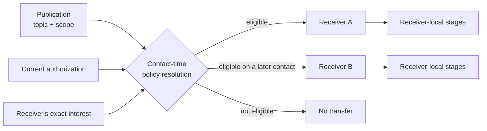
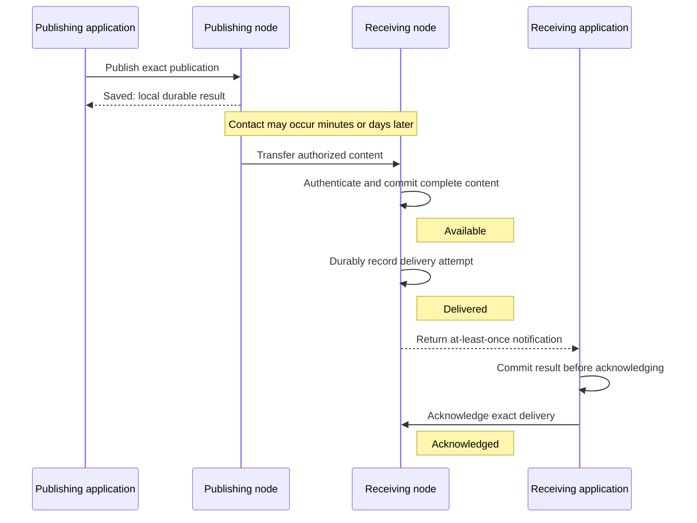
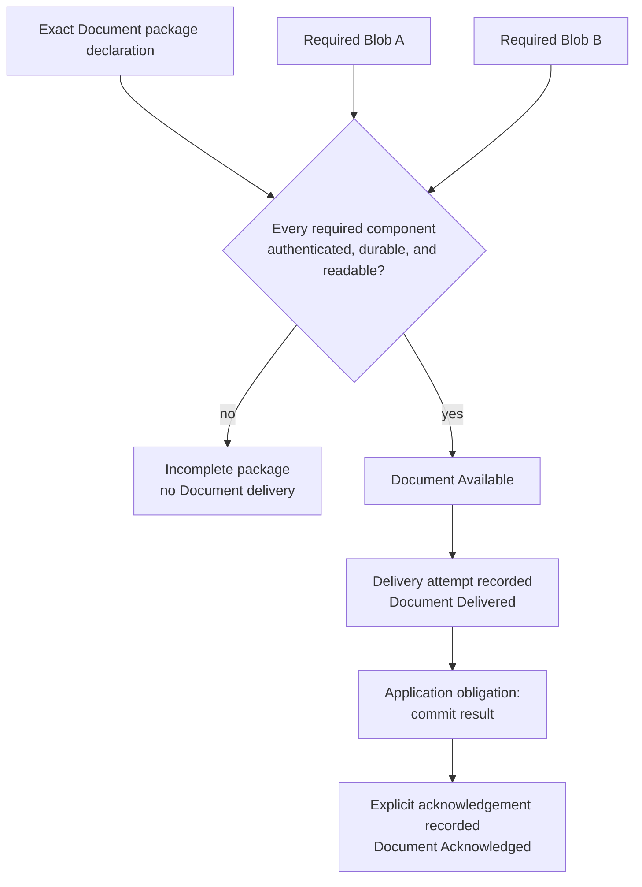

# Decision 0047: Define Blob and Document delivery semantics

Clean Room — Privileged

- Status: proposed
- Date: 2026-11-23
- Decision issue: [#191](https://github.com/defenseunicorns/aster/issues/191)
- Implementation issue: [#200](https://github.com/defenseunicorns/aster/issues/200)

## Context

Aster already separates local publication, receiver-local Blob availability,
application delivery, and application acknowledgement. The terms must remain
distinct for Blob and Document workflows, especially when nodes are offline or
membership changes between contacts.

## Decision

### Recipient intent

A publication targets the dynamic set of receivers selected by policy, not a
frozen recipient list. Topic and scope express routing intent and an
authorization boundary. At each contact, current authorization and the
receiver's configured exact interest determine whether that receiver is
eligible.

Eligibility may change over time. Each receiver therefore evaluates and records
its own stages for each publication. Aster does not expose a publisher-visible
recipient roster or one global "delivered" or "acknowledged" result.

### Lifecycle terms

The stages are separate node observations, not one global status enum:

| Term | Meaning |
|---|---|
| **Saved** | The publishing node durably committed the exact publication and its local metadata. For a Blob, the complete authenticated content and publication are durable before publish succeeds. A successful publish call proves only this local stage. |
| **Available** | One receiver durably stored and authenticated the complete publication and can expose it through its authorized local read surface. Incomplete Blob content remains unavailable. |
| **Delivered** | One receiver durably recorded an at-least-once delivery attempt for the exact publication and returned, or attempted to return, its notification. A lost response may cause redelivery; this stage does not prove application observation or processing. |
| **Acknowledged** | One receiver durably recorded the application's explicit acknowledgement of the exact delivery. The application must commit its result before acknowledging, but Aster does not verify or attest that external commit. |

Application outcomes such as approved, activated, imported, or rejected are
workflow events. They are not delivery acknowledgements.

Each fact is bound to the exact source-authenticated publication, not only its
Blob content identity. Availability can later end through expiry or retirement;
that does not rewrite prior delivery or acknowledgement history.

### Visibility

- The publisher receives a local durable result for **Saved**.
- A receiver can inspect its own **Available** state.
- A receiver records **Delivered** when it commits a subscription attempt. The
  receiving application observes the notification only if the response arrives.
- A receiver records **Acknowledged** only after an explicit application call
  through that subscription's acknowledgement API.
- The current profile does not give the publisher authoritative remote
  availability, delivery, acknowledgement, or group-convergence status.
- Contact completion, stream termination, or a sender finishing its scheduled
  bytes does not prove receiver durability.

Future sender-visible remote status requires an authenticated receipt from the
specific receiver. The receipt must bind receiver identity, exact publication,
stage, and applicable authority generation; prevent replay; and distinguish a
node-attested fact from an application-reported outcome. Such receipts remain
per receiver and must not be inferred from transport completion.

### Document workflow

For the selected workflow, a Document version is an application package: an
exact Record revision plus the immutable Blobs it identifies as required. The
Document stages follow the same meanings:

1. The version is **Saved** when its exact package declaration is durably
   published locally.
2. It is **Available** at a receiver only when the declaration and every
   required component are authenticated, durable, and locally readable.
3. It is **Delivered** when the receiver durably records and returns, or attempts
   to return, a notification for that complete package version.
4. It is **Acknowledged** when the receiver durably records the application's
   explicit acknowledgement. The application must commit its result first;
   Aster does not attest that external commit.

The Document contract must define package identity, required versus optional
components, and replacement behavior before Aster emits Document-level
availability or delivery. Until then, Record and Blob stages remain independent
and must not be presented as aggregate Document completion.

### Implementation contract for #200

Implementation work must preserve these existing boundaries:

- Publish results expose **Saved** as local durability only.
- `BlobPublicationPhase::Available` remains receiver-local availability, not
  sender-visible delivery or convergence.
- Blob and Event subscription ledgers distinguish a durable delivery attempt
  from an explicit acknowledgement and do not attest application business
  effects.
- Public documentation and tests must reject any inference of remote durability
  from contact, stream, or scheduled-byte completion.

Sender-visible remote receipts require a separate reviewed protocol and storage
contract. Aggregate Document status remains blocked on the package and Document
contracts in #166 and #189. Neither is implied by implementing the local stage
terminology.

## Consequences

- Offline publication succeeds after local durable commit and never waits for a
  peer.
- A receiver may be Available without a subscription, Delivered without being
  Acknowledged, or Acknowledged independently of every other receiver.
- Redelivery may continue while the exact publication remains available,
  authorized, selected by an active subscription, and unacknowledged.
  Applications process deliveries idempotently and acknowledge only after
  committing their result.
- Named recipients, all/any/quorum completion, and aggregate group status are
  separate future policy decisions.
- Blob contract work must preserve the distinction between receiver durability
  and application acknowledgement. Event acknowledgement keeps the same
  application-processing meaning.

## Related work

- [#165](https://github.com/defenseunicorns/aster/issues/165): Blob contract
- [#166](https://github.com/defenseunicorns/aster/issues/166): package semantics
- [#167](https://github.com/defenseunicorns/aster/issues/167): Event semantics
- [#169](https://github.com/defenseunicorns/aster/issues/169): transfer overload
- [#171](https://github.com/defenseunicorns/aster/issues/171): protocol failures
- [#172](https://github.com/defenseunicorns/aster/issues/172): lifecycle history
- [#189](https://github.com/defenseunicorns/aster/issues/189): Document contract
