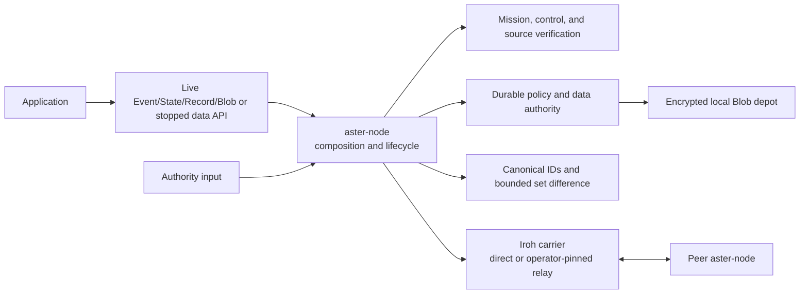
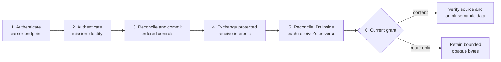

# Carriers and contacts

This guide distinguishes the selected Iroh carrier/storage composition
from the proven semantic implementation whose protocol and carrier behavior is
being migrated onto it. Read [Core concepts](concepts.md) first if terms such as
node, topic, or scope are new.

## Choose your path

| Goal | Start at |
|---|---|
| Run the selected networked implementation | [Selected direct-Iroh contact](#selected-direct-iroh-contact) |
| Inspect the reference components | [Current semantic/reference carrier composition](#current-semanticreference-carrier-composition) |
| Implement a platform BTLE adapter | [Current semantic BTLE integration seam](#current-semantic-btle-integration-seam) |
| Add another carrier | [Carrier migration and extension](#carrier-migration-and-extension) |
| Plan an operational deployment | [Before a real deployment](#before-a-real-deployment) |

## The important separation

Application semantics, mission authentication, control/source authorization,
durable state, reconciliation, and carrier mechanics have separate owners.



`aster-iroh` owns endpoint lifecycle and bounded exchange; its endpoint
identity is not mission membership or data authorization. `aster-core` owns
the hybrid mission session and protected control/source objects.
`aster-profile` and `aster-negentropy` own canonical transfer ordering and
set difference, not policy or causality.

`aster-redb-store` is the mission-bound transaction authority for ordered
control effects, active policy and selector snapshots, accepted objects,
at-least-once Event delivery, durable positive-current-version State delivery,
durable whole-key active-head Record delivery, route-only Event
representations, and local State, Record, and Blob state. The
sibling depot stores bounded Blob ciphertext; redb owns its committed-file
markers and publication authority.
`aster-node` is the only selected composition root.

The selected runtime networks Event, State, and Record and exposes cloneable
live Rust handles for all three through one bounded actor command lane. It also
gives State a durable application subscription/poll/acknowledgement queue for
freshly verified positive current versions and gives Record a separate durable
whole-key active-head queue. Neither application selector mutates its separately
configured network receive interest. The runtime also
exposes a cloneable live Blob handle: publish accepts an already-open regular
file at cursor zero, bounded to 64 MiB and 1,024 canonical 64-KiB chunks, and a
live read returns at most 64 KiB of plaintext per zeroize-on-drop page. The
selected Blob profile and map-unit contract is machine checked:

<!-- ASTER-BLOB-CAPABILITY:BEGIN -->
```json
{
  "schema": 1,
  "surface": "transports",
  "semantic_v7_v8_profile": "4:BlobRangesStreamV1",
  "semantic_v9_profile": "5:BlobStreamV1",
  "map_unit": "1048576-byte native plaintext segment",
  "record": "ASTRBS02, at most 1048706 bytes",
  "data_body": "4-byte length prefix plus one ASTRBS02 record, at most 1048710 bytes"
}
```
<!-- ASTER-BLOB-CAPABILITY:RENDERED -->
Semantic v7/v8 selects profile 4 BlobRangesStreamV1; semantic v9 selects profile 5 BlobStreamV1. Profile 5 maps 1,048,576-byte plaintext segments into append-only ASTRBS02 records of at most 1,048,706 bytes and sends one complete length-prefixed record per DATA body, at most 1,048,710 bytes, without repacking or re-encryption.
<!-- ASTER-BLOB-CAPABILITY:END -->

Profile 5 resumes from lifecycle-owned provisional source or upload state plus
the native pack checkpoint journal. Atomic promotion precedes RESULT;
RESULT_ACK or EOF settles only the attempt and owns no durable resume state.
Profile 4 remains the
compatibility path for peer-neutral contiguous carrier ranges of at most 16 KiB;
v7 is durable-only,
while v8 also implements
authenticated finite-TTL custody and bounded lower-priority pressure recovery
internally. The broader
semantic implementation remains the migration source for behavior that has not
yet moved into this composition.

The retired `aster-host` shared-runtime composition used semantic v8/profile 4.
The selected `aster-node` composition owns semantic-v9/profile-5 streaming.

## Capability boundary

| Path | Implemented | Boundary |
|---|---|---|
| Selected direct Iroh | Manually admitted exact endpoint ID and socket, authenticated direct UDP/QUIC, and bounded exchange | Carrier identity is separate from mission and data authorization; no address discovery, port mapping, dynamic-NAT policy, or multi-carrier failover |
| Selected nearby Iroh discovery | Feature-gated Iroh mDNS lookup using an exact roster or mission-authenticated `--discover-lan`; each window is at most 30 seconds | Default off; upstream observations are not globally capped, so this is not a hostile-LAN or production discovery service |
| Selected controlled Iroh relay | One operator-pinned HTTPS relay with explicit trust, alongside an initial direct locator or with IP disabled | No public/default relay selection; the relay is transport infrastructure rather than an Aster mission or payload-blind application relay |
| Selected node and CLI | Networked Event, State, and Record reconciliation; semantic-v9/profile-5 checkpointed Blob streaming plus semantic-v7/v8 profile-4 compatibility; live and stopped Rust APIs; bounded application delivery; payload-blind Event relay; restart/idempotency; Unix zeroization | Reference provisioning; no cross-transport failover, dynamic application-driven network interests, automatic Record merge, route-only Blob custody, finite State/Record TTL, public Blob lifecycle controls, generalized control administration, or production authorization |
| Current semantic in-memory link | High-level host contact, authentication, reconciliation, resume, and failure behavior | Reference carrier; not wired to the selected composition |
| Linux BlueZ Event evaluation | Fixed-locator Ring 1 uses one exact controller and provisioned peer per process, event-driven availability, deterministic Linux role, bounded retry, and one semantic-v9 ordered Event contact. A separate source-present rostered evaluator adds authenticated transient discovery, a dynamic listener PSM, bounded credential/candidate state, and the same one-peer Event boundary. The Linux `systemd-provider` composition additionally implements bounded automatic controller inventory, passive compatibility probing, sticky selection, and one operational rostered epoch for `Normal` policy. | [Bounded Ring-1 CM4 evidence](validation/evidence/2026-11-05-cm4-btle-ring1-event-validation.md) is evaluation-only. The process-restart failure was bound to CVE-2026-72333 on Linux 6.18.39 by the [clean-restart diagnostic](validation/evidence/2026-11-06-cm4-btle-clean-restart-diagnostic.md); the [fixed-kernel record](validation/evidence/2026-11-06-cm4-btle-clean-restart-validation.md) then observed zero-work restart on Linux 6.18.60 without a controller epoch change. The Debian source profile now presents an optional encrypted roster credential, admits Bluetooth sockets without raw/admin capabilities, and restricts the service user to the exact BlueZ methods used by the adapter. Package construction and payload checks pass, while installed-service execution and qualification remain open: stock `bluer` does not establish acknowledged cancellation-safe advertisement/discovery teardown or a bounded first D-Bus ingress queue, and stock `hmac` does not establish erasure of constructor-derived key/IPAD/OPAD temporaries. No cross-transport fallback, other data class, requirement credit, support claim, or production authorization is claimed. |
| Current semantic BTLE | MTU-aware link, unicast plus an advertisement primitive, disconnect handling, platform `BleRadio` seam | Selected-node integration; a shipped Android, iOS, Linux, or controller-specific radio driver; complete one-to-many profile |
| LoRa, serial, file | The requirements and semantic design do not preclude them | No selected adapters ship |

Deployment evidence and open gates are tracked in
[requirements status](validation/requirements-status.md) and
[conformance](validation/conformance.md); code presence alone is not deployment
credit.

## Selected direct-Iroh contact

Use the [capability tour](quickstart/capability-tour.md) for the fastest two-node
path. The [live mesh CLI quickstart](quickstart/mesh-cli.md) owns the runnable
three-node relay example and the
[four-role control scenario](quickstart/mesh-cli.md#run-the-four-role-control-scenario).

For separately managed processes, initialize a unique persistent state root on
each system, exchange the endpoint IDs printed by `aster init`, and separately
provision a reference mission bundle and mission `NodeId` for each node.
Configure both sides with exact
`CARRIER_ID@IP:PORT=MISSION_NODE_ID_HEX64` bindings and pass each local bundle
through `--mission-bundle-unprotected-reference`. The carrier fails closed when
its handshake identity is not in the configured allowlist; the node then fails
closed unless the mission identity also matches. With no controlled relay or
explicitly feature-gated nearby flags, the direct path performs no address
lookup, relay discovery, or port mapping.

Iroh carrier authentication is not Aster mission authentication and does not
satisfy zero trust by itself. `aster-node` carries the existing `aster-core`
four-flight hybrid session over that carrier, binds mission `NodeId`
independently from Iroh `EndpointId`, and gates inventory on success. Event then
uses the existing source-protected envelope after the existing ordered control
provider has reconciled and activated a gap-free prefix: current peer scope/epoch
route grants remain an upper bound on inventory and Offer; the receiver's
mission-protected canonical Consume/Carry interest narrows each direction
further, and empty interest means receive-none. Content grants gate semantic
acceptance and reaction; revoked mission principals fail closed.

### Short-lived nearby discovery

An explicitly discovery-enabled build also accepts
nearby-peer bindings in the form CARRIER_ID=MISSION_NODE_ID_HEX64 plus a
whole-second nearby window from 1 through 30 seconds. This replaces the manually entered
socket locator; it does not replace either identity. Direct peer routes and a
controlled relay are rejected in the same configuration.

The runtime installs the official Iroh mDNS lookup only for that window and
only under normal emission policy. It publishes direct Iroh carrier addresses
and carrier identity, with no lookup user data. Mission identity, authority,
topic, scope, priority, membership, inventory, and application payload stay out
of DNS-SD records. On-link presence, carrier identity, address, timing, and
packet size remain observable.

That rostered mode remains available. A separate `--discover-lan` mode takes no
`--peer` or `--nearby-peer` value and rejects either combination. Each
whole-second window is 1 through 30 seconds (10 by default); the runtime repeats
windows while it is running and its emission policy remains Normal. An mDNS
result is only an untrusted carrier locator. The runtime completes carrier
authentication, the existing hybrid-PQ mission handshake, and current mission
authorization before inventory. A carrier candidate from a different mission
authority is rejected before application exchange.

Automatic mode retains at most 32 outbound locator candidates and at most 32
distinct mission-authenticated identities for automatic admission before
inventory. At most 16 inbound contact workers and 16 outbound contact workers
run concurrently. These are separate bounds, not a global inbound-carrier cap:
the upstream mDNS provider can observe and retain more peers before Aster's
candidate, admission, and concurrent-worker boundaries apply.

Both modes are default-off and are not hostile-LAN or production discovery
services. Mission proof is scoped to the same contact; this implementation does
not bind it to a TLS exporter or prove common ownership of the carrier and
mission keys. [ADR 0036](decisions/0036-mission-authenticated-lan-discovery-mvp.md)
defines the selected boundary, and the
[three-host LAN Event quickstart](quickstart/lan-mvp.md) gives the operator
procedure.

The live selected Event, State, Record, and Blob handles compose high-level
operations with this path through the running actor's shared bounded command
lane. Blob file work is delegated to a joined worker with capacity one; the
shared application lane has capacity 32. Blob publication and reads require a
fresh selected source, current policy/lineage, and the exact authenticated
`BlobDepotCompletion` capability. A contradiction among durable rows,
authenticated cache state, depot capability, or post-commit verification is a
`FatalBlobCoherence` failure that closes application admission and terminates
the actor rather than becoming an ordinary request error. Event's
`LastContactComplete` reports only the most recent bounded negotiation with each
active configured peer; it does not assert State/Record or global convergence.
The mission bundle is owner-only on Unix but explicitly unprotected-reference
at rest; other platforms fail closed because that owner-only contract cannot be
verified.



The phases above describe the Event lane of the manual direct-Iroh selected slice
with unprotected-reference provisioning. The same mission contact also runs
class-specific State and Record difference/fetch lanes under explicit receiver
topic/scope interests in semantic v4/v5. Under v5, content-capable peers
additionally reconcile exact Blob sources before transferring bounded missing
carrier prefixes; v1-v4 emit zero Blob frames. Carrier authentication does not
grant mission membership, route authority does not grant content access, and a
subscription cannot expand either authority. Consume selectors also drive local
poll delivery; Carry selectors drive receipt/forwarding without local poll
delivery. Both modes project to the same protected wire interest.

On Unix, a same-UID operator can invoke `aster zeroize` against the exact state
and mission-bundle paths. A live node accepts the request only through an
owner-only local socket bound to the state/store inode identities, stops new
work, drains its owned contact tasks, closes its endpoint, and drops derived
secret holders. A stopped node instead obtains the exclusive store writer. Both
paths durably record exact non-secret artifact descriptors before overwriting,
synchronizing, and truncating the retained mission-bundle and carrier-identity
inodes. The pathnames remain owner-only zero-length tombstones, and normal store
open remains terminally denied. Read-only audit inspection and preserved data
rows remain available, as does the encrypted Blob depot. This is cryptographic
shredding of the mission/content and carrier-identity secrets, not deletion or
physical sanitization of depot ciphertext.

This hook is local, not a control message or remote carrier action. It neither
deletes the inode nor guarantees when an arbitrary mid-flight stream disappears
from a remote peer. It makes no claim about physical flash, copy-on-write
history, snapshots, swap, backups, replacement of the retained redb database,
or non-Unix platforms. Exact usage and the crash-resumption boundary are in the
[CLI quickstart](quickstart/mesh-cli.md#trigger-bounded-local-software-zeroization).

## Current semantic/reference carrier composition

The repository also retains the current semantic application and host surfaces:

- `ApplicationNode` is the offline application surface.
- Shared core and binding batch, bridge, and merge APIs remain available.
  The native laboratory host composition and Gate H have been retired.
- `BleLink` implements the opaque-fragment contract.
- The maintained [implementation-boundary table](../README.md#current-implementation-boundary)
  records which operations each Rust and language-binding surface exposes.

## Automatic Linux BTLE Event composition

On Linux builds with `systemd-provider`, an enabled BTLE policy and prepared
roster credential compose `BLE_L2CAP_V1` at epoch zero as `Unavailable`.
`Normal` policy then inventories BlueZ controllers, performs a bounded passive
LE CoC compatibility probe, keeps a healthy choice sticky, and starts at most
one rostered Event epoch. The selector does not see `Available` until the
role-required listener, advertisement, and scan owners are ready. BlueZ,
controller, or transport absence leaves the node ready and local publication
durable.

For the one-exact-peer Event profile, only the validated lower mission member
runs the automatic outbound schedule. It submits one contact request to the
node coordinator and waits for the closed typed outcome; the coordinator keeps
durable custody, selection, and admission authority. The Linux owner derives
the fixed role once from validated local and peer mission identities; the
agent schedule consumes that role without recomputing it. The generic node
owns no BTLE cadence. A
successful contact re-arms 60 seconds after completion. `RetryLater` uses
capped, deterministically jittered backoff, while `Reselect` immediately
submits one fresh Event request. `Suppress`, `Terminal`, and `Cancelled`
authorize no automatic schedule retry. Authenticated `Suppress` parks only the
affected outbound schedule while the adapter owner and transport-neutral
service remain alive. `Terminal` ends the operation; `Cancelled` also covers
coordinated cleanup or shutdown. Undelivered Event work remains durable.

If no eligible transport is available, the node remains ready, publication
remains durable, and the request waits for availability without polling. This
schedule is Linux BTLE policy, not a wire protocol rule. The first profile
accepts configured startup `Normal` and radio-inert `ReceiveOnly`; it rejects a
live BTLE emission-policy change before either the node policy or BTLE owner
changes. The operator must change validated configuration and restart the
agent, rebuilding the policy, credential, radio, registry, and admission state
together.

This composition changes no semantic-v9 bytes and adds no new third-party
package to the workspace lock graph. It advances no requirement credit.
Installed-service execution, supported-hardware rows, physical qualification,
and production authorization remain open; State, Record, and Blob over this
automatic path are not claimed.

The default driver policy permits an unknown probe-compatible controller to
attempt operational activation as `Unqualified`. That means only that the
typed local preflight passed; it does not establish support, qualification,
interoperability, or safe RF lifecycle. A `qualified-only` admission mode
exists in the driver policy API and tests, but the agent configuration does not
expose it. The current agent emits one coalesced allowlisted current-status
record. Detailed driver lifecycle edges remain internal; controller names,
addresses, PSMs, peer IDs, credentials, and detailed probe state do not cross
the boundary.

`ReceiveOnly` registers BTLE unavailable and remains radio-inert because the
current automatic supervisor advertises and scans. `PassiveOnly` is not an
agent configuration option. Per sweep, the resolver retains at most eight
controller candidates and accepts canonical adapter names of at most 64 UTF-8
bytes. BlueZ materializes the adapter-name vector before these limits apply, so
they bound downstream retained candidates and socket, probe, retry, snapshot,
and log work, not BlueZ or D-Bus ingress allocation. They reject pathological
identifiers while covering ordinary Linux adapter names; they are neither
protocol nor support limits and may change without compatibility impact.

The Debian source profile presents the optional encrypted
`aster-btle-roster` credential, admits `AF_BLUETOOTH` without raw/admin
capabilities, and installs a service-user D-Bus allowlist for inventory/property
reads, filtered discovery, and advertisement registration cleanup. Complete
configuration and a valid credential are still required; hardware is selected
automatically and its absence does not gate readiness. Installed-service execution,
support-matrix population, and physical qualification remain open.

## Linux unattended BTLE Event evaluator

The tree includes the separate `aster-btle-event` evaluator for two provisioned
Linux nodes. Each process owns one exact BlueZ controller, one exact peer, and
one Event contact at a time. The transport-neutral node starts before the
Linux-specific supervisor, so BlueZ or controller absence does not block local
durable node operation. With a published Event and matching receiver
application selection already durable, controller availability later starts
the existing mission-authenticated semantic-v9 ordered Event contact;
controller loss cancels and drains that attempt, and restoration starts a
fresh availability epoch.

This lifecycle belongs to `aster-ble-linux`, not the protocol or generic node
runtime. Its deterministic role, retry, and 60-second default success cadence
are implementation policy. The node sees only an adapter-neutral admitted
contact and remains valid when no transport is available.

The claim is evaluation-stage Linux/Linux, one controller, one provisioned
peer, and Event-only. It adds no discovery, transport selection or fallback,
daemon/service boundary, State/Record/Blob execution, requirement credit,
supported-hardware row, or production authorization. See the
[unattended Linux BTLE Event quickstart](quickstart/btle-linux-unattended.md)
for the exact CLI, controller power-cycle procedure, shutdown order, and
evidence boundary.

## Current semantic BTLE integration seam

The BTLE crate deliberately does not choose an operating-system Bluetooth API.
Your platform integration implements the narrow `BleRadio` trait:

```rust
use aster_ble::{BlePacket, BleRadio};
use aster_mesh::NodeId;
use std::io;

struct PlatformRadio {
    // Android, iOS, BlueZ, controller, or device-specific handles live here.
}

impl BleRadio for PlatformRadio {
    fn name(&self) -> &str { "platform-btle" }
    fn unicast_mtu(&self) -> usize { 185 }
    fn broadcast_mtu(&self) -> Option<usize> { None }

    fn send(&self, peer: NodeId, bytes: &[u8]) -> io::Result<()> {
        // Send one already-fragmented opaque packet over L2CAP or GATT.
        todo!()
    }

    fn broadcast(&self, _bytes: &[u8]) -> io::Result<()> {
        Err(io::Error::new(io::ErrorKind::Unsupported, "no advertisements"))
    }

    fn try_receive(&self) -> io::Result<Option<BlePacket>> {
        // Return immediately; Ok(None) means no packet is ready.
        todo!()
    }

    fn set_discovery(&self, enabled: bool) -> io::Result<()> {
        // Map Aster's emission policy to scanning/advertising state.
        todo!()
    }

    fn bits_per_second(&self) -> Option<u64> {
        // Optional current estimate reported through LinkCharacteristics.
        Some(125_000)
    }
}
```

Wrap the platform radio as a carrier:

```rust
use aster_ble::BleLink;

let link = BleLink::new(PlatformRadio { /* platform handles */ }, local_node_id);
link.set_peer_mtu(peer_node_id, negotiated_application_mtu)?;
```

The radio must be nonblocking and must reject outbound packets above its current
useful MTU. `BleLink` silently drops an oversized inbound packet and continues
draining the radio. Override `BleRadio::bits_per_second` when the platform has a
useful current estimate; the default is unknown.

On disconnect, the platform integration must call
`BleLink::disconnected(&peer)` so the peer's link-local negotiated MTU is
removed; verified object progress remains in the core store. The current
`BleLink::new(radio, local_node)` API accepts `local_node` for its composition
shape but does not use it internally, so callers must not rely on the adapter to
check or bind the local identity.

BTLE advertisement support is a carrier primitive. It is not a claim
that the complete authenticated replication exchange has a one-to-many broadcast
profile.

## Carrier migration and extension

The current semantic carrier pattern implements the `Link` contract exposed by
`aster-core`'s `adapter-sdk` feature. It supplies:

- a stable diagnostic name;
- characteristics such as MTU, estimated bit rate, cost, emission footprint, and
  broadcast capability;
- nonblocking send and receive of opaque fragments; and
- discovery enable/disable behavior.

The carrier must not parse application items, invent routing semantics, perform
conflict resolution, or treat transport security as Aster authentication. The
core owns fragmentation, handshake, replay defense, exact reconciliation,
source verification, and reducers.

Use the `Link` trait and retained BTLE adapters as semantic and test migration
sources. The selected node now has an adapter-neutral stream registry and
deterministic selector. The Linux `systemd-provider` composition may register
`BLE_L2CAP_V1` when optional BTLE policy and credential preparation succeed,
including under the Debian service profile. It starts `Unavailable`; `Normal` policy may
make it selectable only after automatic compatibility probing and complete
operational startup. `ReceiveOnly` retains the unavailable registration without
starting radio work. A complete BTLE policy block is active by default;
`"enabled": false` is the explicit opt-out, while an absent block grants no
BTLE authority. Controller presence never supplies missing policy or credential
authority. Each adapter owns its connection state and attempt creation.
Implementing another adapter, or using it as the sole contact-agreed adapter,
does not require changing the Blob stream codec, pipeline, persistence, or
selector. Candidate support
and locators must come from local configuration, provisioned peer data, or
authenticated discovery before `StreamOpen`; peer-supplied ranking is never
accepted. The composition supplies that authenticated support plus local policy
and configured priority to the registry. The selector filters those values and
the stream contract, then orders adapter-reported health, configured priority,
and stable adapter ID. Exactly one adapter carries a logical attempt. Iroh
direct versus relay remains an Iroh-local path observation, not two selectable
Aster transports.

The supervised agent keeps both built-in Iroh contact and adapter selection
closed while authorized transports publish their initial availability, then
opens contact admission once before reporting Ready. Terminal drain closes the
same gate permanently. This ordering is a local runtime detail, not protocol.

Fake adapters validate multi-registration ranking, requirement and policy
filtering, adapter-owned attempt creation, retry, cancellation, terminal
outcomes, and checkpoint carry-forward, but they are not product transport
support. This milestone claims automatic selection of the sole shipped Iroh
adapter and authenticated Iroh reopen. It does not claim best-available
cross-transport selection or failover because no second production adapter or
physical cross-transport scenario has been validated. Semantic v9 already
permits local selection among independently eligible adapters before each fresh
contact; it does not coordinate local ranking across peers. Every selected
contact performs a complete mission handshake and remains bound to one adapter.
Keys, replay state, provisional authorization, frames, and other non-durable
attempt or session state never transfer between adapters; only an existing
receiver-owned Profile-5 durable checkpoint may inform a fresh attempt.

Cross-carrier reselection is permitted only after locally proven adapter
unavailability, link loss, or a transport deadline. A remote or ambiguous
pre-authentication failure neither suppresses the expected peer nor triggers
reselection. Production composition must not enable competing adapters until
the full [BTLE evidence and governance gates](superpowers/specs/2026-11-03-production-btle-design.md#required-evidence-and-governance)
are satisfied. The closed `ContactOutcome` mappings, peer-indexed eligibility,
node-global admission and duplicate arbitration, operational and physical
evidence, independent review, and release authorization are necessary parts of
those gates. Local multi-registration tests are not evidence that competing
adapters may be enabled in a production composition. When another adapter is
implemented, it uses the same registry and must not create a second persistence,
reconciliation, authentication, or scheduling authority. Use the
[binding pattern](bindings/pattern.md) for a language API.

## Semantic protocol versions you may see

Aster separates stable bytes from negotiated behavior. The current selected
implementation offers semantic versions `[9, 8, 7, 6, 5, 4, 3, 2, 1]` in that
descending order:

- **Replication wire/profile version 1** identifies the current encoding and
  fixed security-object family.
- **Semantic version 9** is offered first. It preserves v1-v8 stable bytes and
  selects Blob profile 5 `BlobStreamV1`. Profile 5 is a distinct allocation,
  never a reinterpretation or in-attempt downgrade of profile 4. Its
  `0xd6..0xdc` records, v9 custody/record protection, concurrent Iroh
  data/control pair, adapter-neutral registry and selector, bounded parallel
  segment verification, durable pack checkpoints, resume, and lifecycle
  promotion are implemented. The optional source-level Linux `BLE_L2CAP_V1`
  registration begins unavailable and may carry an Event attempt only after
  automatic operational activation under `Normal` policy. The Debian source
  profile now supplies the required credential/socket/D-Bus boundary, but its
  installed-service execution and hardware qualification remain open. This does not yet
  establish supported packaged BTLE or qualified cross-transport failover.
- **Semantic version 8** inherits semantic-v7 profile
  negotiation and receipt-free Event pages, while profile 4 adds authenticated
  finite-TTL Blob custody and bounded lower-priority pressure recovery.
- **Semantic version 7** remains a compatibility option. After the four-flight mission
  handshake, peers negotiate transfer profiles per lane. Event directions use
  receipt-free ordered pages for exact durable, finite-TTL, tombstone,
  route-only, mixed, and bounded blind ReceiveOnly traffic when both peers
  advertise `EventPagesV1`; only older/non-page peers use the complete
  semantic-v6 Event mechanics. State, Record, and EventBridge use
  `LegacyV6`. Blob requires profile 4 `BlobRangesStreamV1`; both peers must
  support it, and v7 admits durable Blob work only. Page send is an attempt,
  not proof of remote delivery.
- **Semantic version 6** remains a compatibility option. It inherits ordinary Event,
  compact-batch, custody, and State/Record behavior from version 5 and adds
  only the opt-in selected Event-bridge mechanics lane. Blob intent is rejected
  before source or carrier IO; there is no selected carrier fallback. Semantic
  versions 1 through 5 emit zero Event-bridge frames.
- **Semantic version 5** remains a compatibility option. It inherits Event,
  compact-batch, authorized cross-scope route, custody, and semantic-v4
  State/Record behavior. Historical Blob frame allocations remain decodable,
  but Blob intent is rejected before source or carrier IO and does not fall
  back to a selected carrier. Semantic versions 1 through 4 emit zero Blob frames.
- **Semantic version 4** remains a compatibility option with Event behavior and
  protected, class- and direction-specific State/Record reconciliation.
- **Semantic version 3** remains an Event-compatible option with bounded
  session-authenticated Event/RouteEvent custody and no State/Record frames.
- **Semantic version 2** remains a compatibility option for compact batches and
  authorized cross-scope routes without semantic-v3 custody.
- **Semantic version 1** remains a compatibility option for singleton Event
  transfer and has no State/Record or Blob frames.

The process-wide version constants report implementation support, not what a
particular session negotiated. Application code normally does not branch on
these values. See the [compatibility and deprecation
policy](deprecation-policy.md) for support windows, stored-data obligations,
and the required procedure for retiring protocol, suite, ABI, binding, or
registry values.

Transcript binding rejects an unauthenticated on-path rewrite of the offer or
selection, but negotiation does not authenticate a responder's complete
capability set. An older, rolled-back, or modified peer can honestly complete
semantic version 1. A deployment that depends on downgrade resistance must
therefore fail closed at release authorization until it has the authority-signed
minimum, durable per-identity capability high-water, signed rollback
authorization, mixed-version evidence, and independent interoperability
evidence defined by the [deprecation policy](deprecation-policy.md). Version 1
compatibility is not downgrade-resistance evidence.

## Before a real deployment

- Complete the migration ledger in
  [production requirements status](validation/requirements-status.md), and
  do not interpret the direct-Iroh carrier handshake as mission authentication
  or the reference mission session as source-item authorization.
- Issue distinct operational bundles through an approved provisioning process,
  wrap them with an admitted protected-artifact provider, and do not fall back
  to the raw fixture/compatibility path.
- Define persistent secret custody, unattended startup, backup/recovery, and
  destroy behavior separately from artifact encryption.
- Set quotas, retention, priority caps, and sync interests for the device tier.
- Decide how the host obtains peer identities and endpoints.
- Integrate nonblocking carrier readiness and wakeups without polling.
- Capture every enabled physical carrier and compare it with the privacy
  canaries in [Security](security.md).
- Run the relevant loss, bandwidth, restart, alternate-peer, and large-Blob
  scenarios in [Conformance](validation/conformance.md).
- Treat every open item in [Conformance](validation/conformance.md) as an explicit
  acceptance decision, not an implied guarantee.
